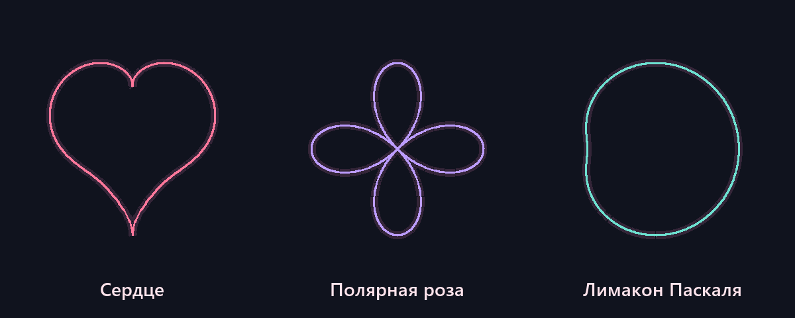
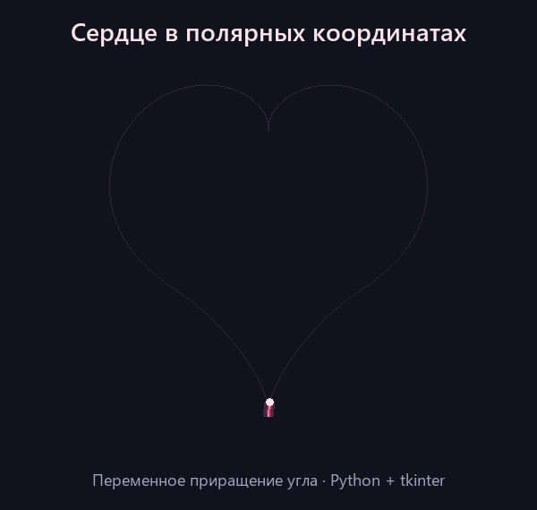

# Сердце в полярных координатах

**Автор:** Стрельцов Андрей  
**Группа:** ПИ25-1  
**Дисциплина:** Практикум по программированию  
**Дата сдачи:** 28.10.2026

## Описание проекта

Учебное приложение на Python и tkinter для задания «Сердце» лабораторной
работы «Простая анимация». Программа строит сердце в полярных координатах
и постепенно прорисовывает его контур с переменным увеличением угла.

Дополнительные пункты задания выполнены в том же приложении: доступны
четырёхлепестковая полярная роза и лимакон Паскаля. Формулы фигур,
состояние анимации и отрисовка разделены по модулям.

## Функциональные возможности

### Основной функционал

- Построение сердца по полярному уравнению.
- Постепенная отрисовка с переменным приращением угла.
- Повтор анимации после короткого показа готового контура.
- Сохранение пропорций при изменении размера окна.

### Дополнительный функционал

- Выбор сердца, полярной розы или лимакона Паскаля.
- Пауза, продолжение и сброс анимации.
- Множитель скорости от 0.25 до 3.
- Режим «Контур целиком» для статической отрисовки любой фигуры.
- Отображение формулы, угла, приращения угла и номера прохода.
- Общий алгоритм отрисовки для всех фигур.

## Демонстрация работы программы

Предпросмотр трёх контуров, построенных по формулам приложения:



Анимационная демонстрация сердца, созданная из математической модели
проекта; интерфейс самого приложения показан при запуске `main.py`:



## Требования к системе

- **Python:** 3.10 или выше.
- **Операционная система:** Windows, macOS или Linux с графическим рабочим
  столом.
- **Графическая библиотека:** tkinter и Tcl/Tk из установки Python.
- **Остальные модули:** только стандартная библиотека Python — `math`,
  `time`, `dataclasses`, `collections.abc`, `unittest`.
- **Внешние пакеты:** отсутствуют; `requirements.txt` содержит пояснение.

Проект проверен на Windows с Python 3.15.2 и Tk 9.0. На Linux tkinter
может устанавливаться отдельным системным пакетом. Проверить наличие
графической библиотеки можно командой `python -m tkinter`.

## Установка и запуск

### 1. Клонирование репозитория

```bash
git clone https://github.com/sav05102003-web/polar-heart-animation.git
cd polar-heart-animation
```

### 2. Создание виртуального окружения

Папка `venv/` включена в Git по прямому требованию методички. Готовое
окружение связано с установкой Python на компьютере автора, поэтому после
клонирования его нужно пересоздать на своём компьютере приведённой ниже
командой. Окружение создаётся без pip: внешних зависимостей у проекта нет.

**Windows (PowerShell или командная строка):**

```powershell
python -m venv --without-pip venv
```

**macOS/Linux:**

```bash
python3 -m venv --without-pip venv
```

### 3. Зависимости и активация

Устанавливать пакеты из PyPI не требуется. tkinter входит в установленный
Python и не устанавливается через pip. Для запуска ниже используется
интерпретатор непосредственно из `venv`, поэтому активация необязательна.

При желании окружение можно активировать:

**Windows PowerShell:**

```powershell
.\venv\Scripts\Activate.ps1
```

**Windows cmd:**

```bat
venv\Scripts\activate.bat
```

**macOS/Linux:**

```bash
source venv/bin/activate
```

Если PowerShell запрещает выполнение `Activate.ps1`, используйте запуск
интерпретатора из следующего шага: изменение политики выполнения не нужно.

### 4. Запуск программы

Выполняйте команды из корневой папки проекта.

**Windows:**

```powershell
.\venv\Scripts\python.exe main.py
```

**macOS/Linux:**

```bash
./venv/bin/python main.py
```

Если окружение активировано, достаточно команды `python main.py`.

### 5. Управление

| Элемент | Действие |
| --- | --- |
| Список фигур | Выбрать сердце, розу или лимакон; начать новый проход |
| «Пауза» / «Продолжить», пробел | Остановить или продолжить отрисовку |
| «Сначала», R (К в русской раскладке) | Сбросить угол и номер прохода |
| Ползунок скорости | Изменить скорость от 0.25× до 3× |
| «Контур целиком» | Показать фигуру сразу; позиция анимации сохраняется |
| Esc или закрытие окна | Завершить приложение |

Сброс и смена фигуры сохраняют выбранную скорость и состояние паузы.
В режиме полного контура кнопка паузы недоступна. Кнопка «Сначала»
возвращает режим анимации, сохраняя паузу, если она была включена.

## Математическая модель

Для всех фигур используются полярные координаты и общий переход к
декартовым координатам:

```text
x = r(θ) · cos θ
y = r(θ) · sin θ
```

**Сердце:**

```text
r(θ) = 2 − 2sin θ + sin θ · √|cos θ| / (sin θ + 1.4)
```

Знаменатель не обращается в ноль, поскольку `sin θ + 1.4 ≥ 0.4`.
Верхняя выемка находится при `θ = π/2`, нижнее острие — при `θ = −π/2`.

**Четырёхлепестковая полярная роза:**

```text
r(θ) = 2.4cos(2θ)
```

Отрицательный радиус допустим: он задаёт точку на противоположном луче.

**Лимакон Паскаля:**

```text
r(θ) = 2 + 1.2cos θ
```

Угол проходит один оборот от `−π/2` до `3π/2`. Его увеличение переменно:

```text
Δθ = 1.5 · speed · (0.6 + 0.4cos²(2θ)) · Δt
```

Время измеряется через `time.perf_counter()`. Каждый кадр разбивается на
шаги не более `1/240` секунды, чтобы результат мало зависел от частоты
кадров. `after(16, ...)` планирует следующий кадр без блокирующего `sleep`
в главном цикле. При задержке окна приложение ограничивает время одного
кадра величиной 0.1 секунды, избегая резкого скачка.

Контур содержит 1000 отрезков; отрисованная часть определяется текущим
углом. В конце прохода готовая фигура остаётся видимой 0.8 секунды.
Масштабирование одинаково по обеим осям; экранная ось Y перевёрнута.
Объекты Canvas переиспользуются, поэтому их число не растёт с кадрами.

## Структура проекта

```text
polar-heart-animation/
├── .gitattributes
├── .gitignore
├── README.md
├── requirements.txt
├── main.py
├── docs/
│   ├── figures.png
│   └── heart.gif
├── src/
│   ├── __init__.py
│   ├── app.py
│   ├── models/
│   │   ├── __init__.py
│   │   ├── heart.py
│   │   ├── figures.py
│   │   └── animation.py
│   ├── renderers/
│   │   ├── __init__.py
│   │   └── heart_renderer.py
│   └── widgets/
│       ├── __init__.py
│       └── controls.py
├── tests/
│   ├── __init__.py
│   ├── test_geometry.py
│   ├── test_animation.py
│   └── test_app.py
└── venv/
    ├── pyvenv.cfg
    └── Scripts/
```

На macOS/Linux после создания окружения вместо `Scripts/` используется
папка `bin/`.

**Назначение основных модулей:**

- `main.py` — точка входа.
- `app.py` — окно, связь компонентов, события и планирование кадров.
- `heart.py` — формула сердца, перевод координат и выборка контура.
- `figures.py` — дополнительные формулы и каталог фигур.
- `animation.py` — угол, скорость, пауза и повтор проходов.
- `heart_renderer.py` — масштабирование и работа с Canvas.
- `controls.py` — кнопки, выбор фигуры и ползунок.
- `tests/` — проверки математики и связи с интерфейсом.

Такая структура отделяет вычисления от интерфейса: математику можно
тестировать без окна, а для добавления фигуры достаточно функции `r(θ)`
и записи `Figure` в `FIGURES`. Менять анимацию или отрисовку не нужно.

## Пример использования

1. Запустите `main.py`: начнётся отрисовка сердца.
2. Нажмите пробел и убедитесь, что движение остановилось.
3. Выберите «Полярная роза», затем нажмите «Продолжить».
4. Передвиньте ползунок к 2× и сравните скорость отрисовки.
5. Включите «Контур целиком», чтобы рассмотреть фигуру.
6. Выберите «Лимакон Паскаля», затем нажмите «Сначала».
7. Нажмите Esc для выхода.

## Проверка работы

**Windows:**

```powershell
.\venv\Scripts\python.exe -m unittest discover -s tests -v
```

**macOS/Linux:**

```bash
./venv/bin/python -m unittest discover -s tests -v
```

Всего 21 тест: геометрия и замыкание контуров, симметрия сердца,
отрицательные радиусы розы, переменный шаг угла, независимость от частоты
кадров, пауза, сброс, повтор, скорость, смена фигур и размер окна.
GUI-проверки требуют графической среды; без неё они пропускаются.

## История разработки

Первый коммит содержит только `README.md`; его сообщение —
`Стрельцов Андрей`. Следующие коммиты отдельно добавляют структуру и venv,
статическое сердце, анимацию и управление, дополнительные фигуры,
тесты и документацию.

```bash
git log --oneline --reverse
```
