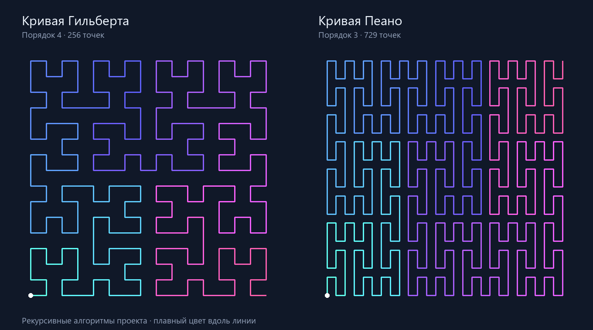

# Кривая Гильберта

**Автор:** Стрельцов Андрей  
**Группа:** ПИ25-1  
**Дисциплина:** Практикум по программированию  
**Работа:** Лабораторная 2 «Сложная анимация», тема «Кривая Гильберта»  
**Дата сдачи:** 28.10.2026

## Описание проекта

Приложение на Python и tkinter рекурсивно строит кривую Гильберта и
постепенно рисует её с плавным изменением цвета вдоль линии. Можно менять
глубину рекурсии и скорость, останавливать анимацию и рассматривать готовую
кривую. В качестве дополнительного задания реализована кривая Пеано на том
же движке отрисовки.

## Функциональные возможности

### Основной функционал

- Рекурсивное построение кривой Гильберта порядков от 1 до 7.
- Начальный порядок 3: хорошо различимая кривая из 64 точек.
- Постепенная отрисовка с движением кончика между вершинами.
- Плавный переход цвета от бирюзового через синий к розовому.
- Сохранение пропорций и прогресса при изменении размера окна.

### Дополнительный функционал

- Рекурсивная кривая Пеано порядков от 1 до 4.
- Выбор кривой и порядка без перезапуска программы.
- Пауза, продолжение, повтор и немедленный показ всей кривой.
- Скорость от 0.25× до 4×, полоса прогресса и сведения о сетке.
- Управление кнопками и клавиатурой.
- Проверки геометрии, времени и настоящего окна Tkinter.

## Демонстрация работы программы

Визуализация точек, вычисленных алгоритмами проекта. Это иллюстрация
математической модели; интерфейс открывается командой `python main.py`.



Ускоренная демонстрация построения Гильберта четвёртого порядка,
сформированная из той же математической модели:


## Требования к системе

- **Python:** 3.10 или выше с поддержкой Tcl/Tk.
- **Операционная система:** Windows, macOS или Linux с графическим столом.
- **Графическая библиотека:** `tkinter`, входящая в установку Python.
- **Остальные зависимости:** стандартные модули `math`, `time`, `colorsys`,
  `dataclasses`, `functools`, `typing`; для тестов — `unittest` и `types`.
- **Пакеты из PyPI:** не требуются. `requirements.txt` содержит пояснение.

`tkinter` не устанавливается через pip. В установщике Python для Windows
включите компонент Tcl/Tk. В Debian/Ubuntu при необходимости установите
системные пакеты `python3-tk` и `python3-venv`. Проверка установки:

```bash
python -m tkinter
```

Должно открыться тестовое окно Tk. На macOS/Linux можно использовать
`python3` вместо `python`.

## Установка и запуск

### 1. Клонирование репозитория

```bash
git clone https://github.com/sav05102003-web/fin_ppp_sem_3.git
cd fin_ppp_sem_3/hilbert-curve
```

Все последующие команды выполняйте из папки `hilbert-curve`.

### 2. Создание и активация виртуального окружения

По прямому требованию методички `venv/` включён в Git и не добавлен в
`.gitignore`. Виртуальные окружения содержат пути к локальному Python и
не переносятся между компьютерами: после клонирования пересоздайте его.
Параметр `--clear` очищает только папку `venv`.

В публикуемой копии окружения удалены абсолютные локальные пути:
скрипты активации определяют каталог относительно себя, а `pyvenv.cfg`
содержит относительный путь к Python среды разработки. Это не делает
окружение переносимым: на другом компьютере выполните пересоздание ниже.

**Windows PowerShell:**

```powershell
python -m venv --clear venv
.\venv\Scripts\Activate.ps1
```

**Windows cmd:**

```bat
python -m venv --clear venv
venv\Scripts\activate.bat
```

**macOS/Linux:**

```bash
python3 -m venv --clear venv
source venv/bin/activate
```

Если PowerShell запрещает активацию, используйте интерпретатор напрямую:

```powershell
.\venv\Scripts\python.exe main.py
```

### 3. Установка зависимостей

В пересозданном и активированном окружении:

```bash
python -m pip install -r requirements.txt
```

Внешних пакетов в файле нет, поэтому эта команда ничего не устанавливает.
Сохранённое учебное окружение создано с `--without-pip`: приложению pip не
нужен. Если используете именно его, пересоздайте окружение по шагу 2 или
установите pip командой `python -m ensurepip`.

### 4. Запуск программы

```bash
python main.py
```

Без активации на Windows: `venv\Scripts\python.exe main.py`.
Без активации на macOS/Linux: `./venv/bin/python main.py`.

### 5. Управление

| Элемент или клавиша | Действие |
| --- | --- |
| Список «Кривая» | Выбрать Гильберта или Пеано, начать новый проход |
| Список «Порядок» | Изменить глубину рекурсии, начать новый проход |
| Ползунок скорости | Изменить скорость от 0.25× до 4× |
| «Пауза» / «Продолжить», пробел | Остановить или продолжить проход |
| «Сначала», R (К в русской раскладке) | Начать текущую кривую заново |
| «Показать всё», Enter | Показать всю кривую сразу |
| ↑ / ↓ | Увеличить / уменьшить порядок, если фокус вне списков |
| Tab | Переместить фокус между элементами управления |
| Esc | Закрыть приложение |

В раскрывающихся списках стрелки выполняют стандартный выбор пункта.
Пауза и скорость сохраняются при смене кривой, порядка и сбросе.
Если рисунок завершён, кнопка паузы недоступна; для повтора нажмите
«Сначала». Если ранее была включена пауза, затем нажмите «Продолжить».
При выборе Пеано после высоких порядков Гильберта порядок автоматически
ограничивается четвёртым.

## Структура проекта

```text
hilbert-curve/
├── .gitattributes
├── .gitignore
├── README.md
├── requirements.txt
├── main.py
├── docs/
│   ├── curves.png
│   └── hilbert.gif
├── src/
│   ├── __init__.py
│   ├── app.py
│   ├── models/
│   │   ├── __init__.py
│   │   ├── curves.py
│   │   └── animation.py
│   ├── renderers/
│   │   ├── __init__.py
│   │   └── curve_renderer.py
│   └── widgets/
│       ├── __init__.py
│       └── controls.py
├── tests/
│   ├── __init__.py
│   ├── test_curves.py
│   ├── test_animation.py
│   └── test_app.py
└── venv/
    ├── pyvenv.cfg
    └── Scripts/                 # учебное окружение Windows
```

На macOS/Linux при пересоздании окружения вместо `Scripts/` появляется
папка `bin/`.

**Назначение основных модулей:**

- `main.py` — точка входа.
- `curves.py` — рекурсивные алгоритмы и каталог доступных кривых.
- `animation.py` — время, скорость, прогресс и состояние паузы.
- `curve_renderer.py` — масштабирование, интерполяция и цветные линии.
- `controls.py` — списки, кнопки и ползунок.
- `app.py` — окно, клавиатура, связь компонентов и таймеры.
- `tests/` — проверки математики и её связи с интерфейсом.

Структура разделяет математику, отрисовку и управление. Геометрию можно
проверять без окна; для новой кривой достаточно алгоритма и записи
`CurveSpec` в `CURVES`. Анимация и Renderer для Пеано используются без
изменений.

## Пример использования

1. Запустите `python main.py`: начнётся построение Гильберта порядка 3.
2. Нажмите пробел: кончик и полоса прогресса остановятся.
3. Выберите порядок 5: рисунок очистится, пауза сохранится.
4. Установите скорость 2× и нажмите «Продолжить».
5. Нажмите Enter, чтобы рассмотреть готовую кривую.
6. Выберите «Кривая Пеано»: порядок станет 4, начнётся новый проход.
7. Нажмите «Сначала» для повтора, Esc — для выхода.

## Как работает алгоритм

### Рекурсия Гильберта

Базовый уровень рекурсии содержит одну точку `(0, 0)`. Порядок `n`
составляется из четырёх преобразованных копий порядка `n − 1`.
Для каждой точки `(x, y)` меньшего порядка и `s = 2**(n − 1)`:

```text
1. (y, x)
2. (x, y + s)
3. (x + s, y + s)
4. (2s − 1 − y, s − 1 − x)
```

Каждое преобразование применяется ко всей предыдущей кривой, затем четыре
списка соединяются в указанном порядке. Отражения соединяют квадранты
соседними точками сетки. Первый порядок:
`(0, 0) → (0, 1) → (1, 1) → (1, 0)`.

### Рекурсия Пеано

Квадрат делится на девять частей вместо четырёх. Девять копий предыдущей
кривой обходятся змейкой по трём столбцам. В нечётных строках отражается
координата X, в нечётных столбцах — Y: выход каждой копии оказывается
рядом со входом следующей.

| Свойство | Гильберт | Пеано |
| --- | --- | --- |
| Сторона сетки | `2**n` | `3**n` |
| Число точек | `4**n` | `9**n` |
| Допустимый порядок | 1–7 | 1–4 |
| Максимальное число точек | 16 384 | 6 561 |
| Конечные точки | Соседние углы | Противоположные углы |

Конечная итерация — приближение заполняющей плоскость кривой: она посещает
все узлы выбранной сетки, а не все точки непрерывного квадрата. Заполнение
всего квадрата относится к пределу при бесконечном увеличении порядка.
Сложность построения и хранения — `O(4**n)` для Гильберта и `O(9**n)` для
Пеано. Глубина рекурсии — `O(n)`; предыдущие порядки кешируются.
Ограничения порядка удерживают объём вычислений в разумных рамках.

### Анимация и цвет

`time.perf_counter()` измеряет время между кадрами. Прогресс изменяется
по формуле `progress += Δt × speed / 12`, ограничиваясь единицей.
При 1× проход занимает около 12 секунд активного рисования, при 2× —
около 6 секунд, независимо от числа точек. На паузе прогресс не меняется.
Следующий кадр назначается через `after(16, ...)`.

Внутри текущего отрезка кончик движется по линейной интерполяции.
При задержке событий учитывается максимум 0.1 секунды за кадр: после
долгого перемещения окна рисунок не перескакивает к концу, но реальный
проход в таком случае займёт больше времени.

Цвет задаётся в HSV: `H = 0.48 + 0.44 × t`, `S = 0.62`, `V = 0.98`,
где `t` — позиция вдоль линии. Используются до 192 цветовых участков:
цвет меняется мелкими шагами, создавая плавный градиент. При малом порядке
отдельный цвет получает каждый отрезок. Объекты Canvas переиспользуются;
их не более 195 даже на максимальном порядке. Масштаб по X и Y одинаковый,
экранная ось Y перевёрнута.

## Проверка работы

В активированном окружении:

```bash
python -m unittest discover -s tests -v
```

Без активации на Windows:

```powershell
.\venv\Scripts\python.exe -m unittest discover -s tests -v
```

Проверено 28.10.2026 на Windows с Python 3.12.14 и Tcl/Tk 8.6.12:
**24 теста пройдены, пропущенных тестов нет.** Проверки запускались
интерпретатором созданного виртуального окружения.

Проверяются все допустимые порядки обеих кривых: заполнение сетки без
повторов, соседство точек, границы и концы кривых. Также проверяются
пауза, скорость, независимость от частоты кадров, смена кривой, настоящий
таймер Tkinter, положение кончика, масштабирование, клавиши и постоянное
число объектов Canvas. Без графической среды GUI-проверки пропускаются
с указанием причины, а математические проверки выполняются.

Для ручной проверки запустите приложение, сравните порядки 1, 3 и 6,
проверьте паузу, изменение скорости, сброс и выбор Пеано. Измените размеры
окна: квадратная сетка должна сохранить пропорции, прогресс — позицию.

## История разработки

Первый коммит этого проекта содержит только `README.md`, сообщение —
`Стрельцов Андрей`. Последующие коммиты добавляют структуру и venv,
рекурсивную модель, интерфейс и анимацию, кривую Пеано, тесты и документацию.
История проекта из корня общего репозитория:

```bash
git log --oneline --reverse -- hilbert-curve
```

Для сдачи работы используйте ссылку на
[папку проекта](https://github.com/sav05102003-web/fin_ppp_sem_3/tree/main/hilbert-curve).
